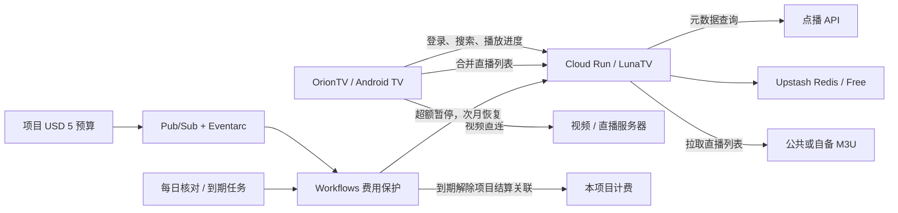

# OrionTV + LunaTV on Cloud Run

给 Android TV / 投影仪使用的家庭电视后端：**OrionTV 播放，LunaTV 提供搜索、片单、登录与进度，Upstash 保存数据，视频由电视直接连接片源。** 支持影视点播和 M3U 直播。

本仓库是一次家庭部署的可复现源码与配置包，包含 LunaTV 源码快照及必要改动。**不包含桌面、壁纸、坚果系统适配、客户端 APK、账号密钥或设备备份。** OrionTV 客户端使用 [orion-lib/OrionTV](https://github.com/orion-lib/OrionTV) 的正式发行版。

## 默认配置

| 项目 | 配置 |
| --- | --- |
| Cloud Run | `asia-east1`，1 CPU / 512 MiB，按请求计费，最小 0 / 最大 1 实例，并发 20 |
| 视频中转 | 禁止 `/api/proxy/m3u8`、`segment`、`key`；投影仪直连 |
| 后台任务 | 禁用进程内定时任务与 `/api/cron` |
| 直播列表 | 后端把启用的 `lives` 合并成一个 M3U，电视用带 token 的地址读取；视频仍由电视直连 |
| 数据库 | 独立 Upstash Redis，使用 REST API；原部署为 Free 计划 |
| 月度保护 | USD 5，排除 credits；Cloud Run 原生 Spend Cap + 整个项目预算事件 |
| 跨月恢复 | 太平洋时间每天 00:10，仅恢复上月被预算保护暂停的服务 |
| 固定到期 | **2027-10-22 00:00 Asia/Taipei**，关闭本项目计费，不再自动恢复 |

**USD 5 是自动保护阈值，不是严格账单上限。** Google 的费用统计与通知有延迟；构建、镜像和密钥存储也会计费。到期解除项目结算关联后不再产生新的 GCP 用量费用，但已经发生的费用可能延后入账。Upstash 是独立服务，不受 GCP 计费开关控制。

## 从哪里开始

1. [部署云端服务与来源配置](docs/deployment.md)：专用 GCP 项目、Upstash、Secret Manager、构建和部署。
2. [OrionTV 客户端接入](docs/oriontv.md)：设置后端、登录、直播与点播。
3. [费用保护与到期处理](docs/cost-guard.md)：规则、权限、核验和延期方式。
4. [验证记录与范围](docs/verification.md)：区分原部署的实机测试和此源码包的检查。
5. [来源、修改与许可证](THIRD_PARTY_NOTICES.md)。

需要 Python 3.10+、已登录的 Google Cloud CLI。LunaTV 镜像由 Cloud Build 构建，本机不必安装 Node 或 Docker。Cloud Run 能缩至 0，使用时存在冷启动等待；无需保持家里的电脑开机。

## 仓库结构

- `vendor/LunaTV/`：固定提交的完整运行源码，含直连/禁后台任务、标题匹配及直播列表合并改动，详见来源说明。
- `cloud/`：非秘密配置模板、云端初始化/部署脚本、来源示例。
- `cloud/cost-guard/`：预算、工作流、IAM、定时任务与只读演练。
- `docs/`：部署、接入、恢复与验证说明。
- `.local/`：自己复制的配置和部署回执，Git 忽略；不要提交。

源码包没有迁移原部署的凭据、收藏、观看进度或其他数据库内容。GitHub 可下载源码 ZIP；恢复部署时仍需要自己的 GCP、Upstash 与密钥。
